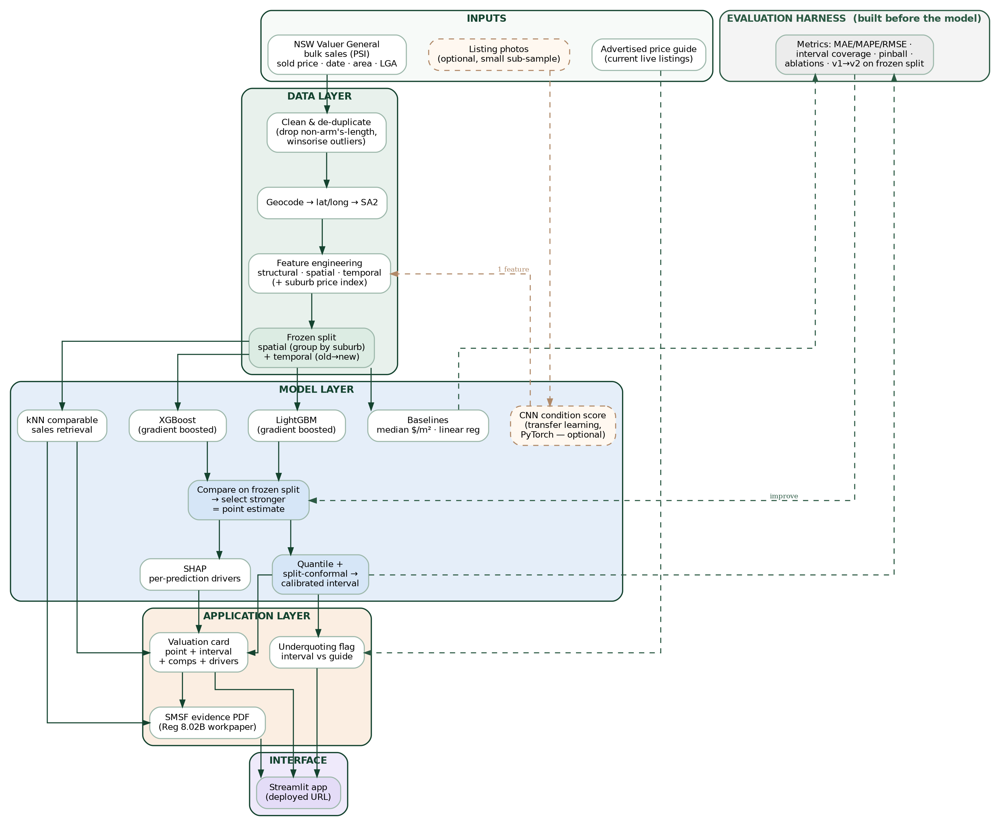

# Guide Check

A calibrated residential valuation with its evidence attached, for a regulated
decision. One engine, one output, two applications:

- an **SMSF Reg 8.02B evidence pack** an accountant can file
- a **prospective underquoting flag** on a live advertised guide

Unit FIN80031 AI for Finance and Accounting, Assessment 2. Swinburne University
of Technology.

**Live demo:** https://guide-check-dheeransh.vercel.app

Built as a team project, with contributions from Sushant Shrestha and Shrey Patel.

---

## Reproduce everything

```bash
python -m venv .venv && .venv/Scripts/activate      # Windows
pip install -r requirements-dev.txt
python src/run_all.py                                # ~15-25 min
python app.py                                        # the web app, as deployed
streamlit run app/streamlit_app.py                   # the Streamlit demo
```

`run_all.py` will not overwrite an existing `data/processed/splits.json` — the
freeze is respected, so re-running cannot quietly change the test set.

Python 3.11.9. Data is downloaded once to `data/raw/psi.zip` (74 MB).

---

## Results on the frozen test set

119,095 sales from 2025-10-01 to 2026-08-20, never seen during training or
calibration.

| Arm | MAPE | MedAPE | MAE |
|---|---|---|---|
| **LightGBM (selected)** | **25.81%** | 16.76% | $329,153 |
| XGBoost | 25.89% | 17.13% | $330,923 |
| + drift correction (v2) | 25.90% | **15.88%** | **$321,746** |
| Linear regression baseline | 36.57% | 22.24% | $448,438 |
| Suburb median $/m² baseline | 41.33% | 29.39% | $498,922 |

**37.5% better than the baseline it has to beat.**

### Interval calibration — the centrepiece

| Interval method | Nominal | Empirical coverage | Gap |
|---|---|---|---|
| Raw quantile band | 80% | 72.2% | −7.8 pp |
| Split-conformal (CQR) | 80% | 75.7% | −4.3 pp |
| MAPIE split-conformal | 80% | 77.6% | −2.4 pp |
| **CQR + drift correction (v2)** | 80% | **77.6%** | **−2.4 pp** |

**We do not reach nominal coverage, and we report that.** Calibration closes
most of the gap (72.2% → 77.6%) but not all of it. The reason is known and
was predicted before we measured it: split-conformal assumes the calibration
and test sets are exchangeable, and market drift between a 2025 calibration
window and a 2025-26 test window breaks that assumption. A tight but
miscalibrated interval is a failure, so we state the number.

### The improvement loop (v1 → v2)

One change, measured on the identical frozen split: a market-drift correction
estimated on the calibration window only. The v1 model under-predicted by ~7%
because trees cannot extrapolate a time trend past their training data.

| | MedAPE | MAE | Coverage |
|---|---|---|---|
| v1 | 16.76% | $329,153 | 75.7% |
| v2 | **15.88%** | **$321,746** | **77.6%** |

### Ablations

| Feature group removed | MAPE | Δ |
|---|---|---|
| (none) | 25.81% | — |
| index | 25.83% | +0.02 |
| spatial | 26.82% | +1.01 |
| structural | 28.52% | +2.71 |
| **temporal** | **30.58%** | **+4.77** |

Temporal features carry the most signal. Spatial and index features are largely
redundant with each other — each substitutes for the other when removed, which
is why dropping either alone costs little.

---

## The underquoting assessment — rebuilt

The first version was a binary flag: `guide < lower_bound × 0.95`. Measured on
the frozen test set it caught a real 20% underquote **1 time in 4**, while
wrongly flagging **1 honest guide in 15**. Narrowing the population did not
help — 119k rows down to 17.7k Sydney-metro houses moved the catch rate from
25.5% to only 26.1%.

**The target was wrong, not the accuracy.** "Will this sell for more than the
guide?" conflates two different things:

| | What it is |
|---|---|
| Sold 15% above guide in a hot auction | Normal market behaviour |
| Guide set below what comparable sales plainly supported | Underquoting |

No price model can separate them, because the quantity that matters — the
agent's *reasonable estimate at listing time* — is unobserved. NSW law asks the
narrower question: **is the guide defensible against comparable sales?** So
that is what we now assess.

### What replaced it

**1. Comps-anchored valuation** (`src/comps_estimator.py`). The model no longer
predicts the price directly; it adjusts comparable sales for how they differ
from the subject: `adjusted = comp_price × [model(subject) / model(comp)]`.
Taking a ratio cancels much of the model's level error. Measured on 1,400
sampled test sales:

| Segment | Comps-anchored | Model alone |
|---|---|---|
| Metro | **13.2%** error, **99.9%** centred | 13.9%, 96.7% |
| Regional | **16.6%** error, **96.6%** centred | 17.0%, 92.4% |

**2. A percentile, not a verdict.** "This guide sits at the 12th percentile of
25 comparable sales" has no arbitrary threshold and degrades gracefully. The
app also reports the calibrated probability the property is worth more than the
guide, computed from held-out residuals (`src/residuals.py`) — no distributional
assumption, just measured errors.

**3. Honest error reporting in the UI.** Every assessment states the typical
error for that segment (metro 14.3%, regional 16.0%) and that the 80% range
actually covers 77.6%.

**4. Real cases instead of simulation** (`src/hardcases.py`). Simulated
discounts cannot encode the distinction in the table above. The scaffold takes
labelled cases — `underquoted` vs `defensible` — and sweeps the percentile
cutoff. **It currently has no real rows, so the guide assessment has no
validated accuracy**, and the code says so rather than inventing a number.

**5. Live-listing input.** `serve.value_manual()` and the app's "Check a
listing" mode take an address, suburb, type, land area and guide. Bedrooms and
bathrooms are accepted and stored but **cannot affect the estimate** — they do
not exist in PSI. `data/reference/listing_template.csv` is the collection
schema so that dataset can start being built now.

## The two hard rules, and how they were kept

**The evaluation harness was built before the model.** `harness.py` reads only
`splits.json` and a predictions file. It was proven by
`make_fake_predictions.py`, which fabricates predictions with a known +12% bias
and a band engineered to cover exactly 70% against a nominal 80%. The harness
recovered `70.000%` empirical coverage and a `−10.000 pp` gap. Only then was a
model trained.

**The test split is frozen, blocked by geography and time.** Temporal: train
< 2025-01-01, calibrate to 2025-09-30, test from 2025-10-01. Spatial:
`GroupKFold` grouped by SA2 within training, so neighbours never sit in both
the fitting and scoring folds. `splits.json` carries the freeze date and commit.

The join key is `sale_key` (`property_id-date-price`), **not** a row number.
A positional index would be silently renumbered by any cleaning change, quietly
invalidating the freeze.

---

## Layout

```
src/clean.py                D1-D3  ingest, clean, geocode
src/split.py                D5     freeze the split
src/features.py             D4     feature engineering (index fitted on train only)
src/harness.py              H1     evaluation harness
src/make_fake_predictions.py       the harness gate
src/baselines.py            M1     median $/m2, linear regression
src/train_point.py          M2     LightGBM vs XGBoost, compare and select
src/train_interval.py       M3     quantile + conformal
src/improve_v2.py                  the v1 -> v2 improvement
src/comps.py                M4     kNN comparable-sales retrieval
src/serve.py                M5     serving layer: card, SHAP, underquoting flag
src/smsf_pdf.py             A3     Reg 8.02B evidence pack
src/ablation.py                    feature-group ablations
src/run_all.py                     one-command reproduction
src/comps_errors.py                typed-in comps error, the yardstick for guides
src/selftest.py                    400 labelled cases for the guide assessment
app.py + public/                   the web app (Flask), deployed to Vercel
app/streamlit_app.py        A1/A2  the Streamlit demo
docs/DATA-REPORT.md                what is actually in the source data
```



Step-by-step setup and troubleshooting: [RUNNING.md](RUNNING.md).

---

## Data

**NSW Valuer General Property Sales Information.** Free, public, settled sale
prices reported under NSW land title dealings — not asking prices, not
estimates.

| Source | Link |
|---|---|
| Cleaned CSV mirror (used) | https://nswpropertysalesdata.com/ |
| Official bulk PSI | https://valuation.property.nsw.gov.au/embed/propertySalesInformation/ |
| PSI format docs | https://www.valuergeneral.nsw.gov.au/design/bulk_psi_content/bulk_psi |
| Suburb centroids + SA2 | https://github.com/matthewproctor/australianpostcodes |

The mirror is an independent project, **not** an official mirror. It republishes
government records in a usable form. See `docs/DATA-REPORT.md` for a full
profile of 1.5M rows and the three cleaning traps we found in it.

---

## Known limitations

Stated plainly, because the evaluation marks reward honesty over polish.

1. **Coverage is 77.6% against a nominal 80%.** Not calibrated to target. Cause
   identified (temporal drift breaking exchangeability); partially corrected.
2. **Intervals are wide** — around 78% of the point estimate. The model has
   real uncertainty and the interval reports it rather than hiding it.
3. **Suburb-centroid geography, not street-level.** PSI carries no coordinates,
   and street-level geocoding of 1.2M addresses was not available to us.
   Within-suburb location effects are therefore not captured.
4. **No bedrooms or bathrooms.** They do not exist in PSI. This is the single
   largest missing feature and a likely cause of the wide intervals.
5. **No CNN condition score.** The optional vision stream was not built; the
   ablation harness has the slot for it (`vision_on` / `vision_off`).
6. **`dist_station_km` not implemented** — no station-location dataset was
   sourced. `dist_cbd_km` is present.
7. **Underquoting uses a synthetic guide.** No advertised-guide data was
   collected, so the demo derives a guide from the sale price to exercise the
   logic. Real guides must be collected from live listings.
8. **The nominal-transfer filter is deliberately conservative** (15% of the
   suburb × property-type median). Some questionable low sales survive it.
9. **Deployment footprint.** The live demo is `app.py` from this repo on
   Vercel. The feature table is **278 MB in memory** and the four artefacts
   it loads are **123 MB on disk**, so the function is ~580 MB with its
   dependencies and needs Vercel's large-function support. The first request
   after an idle period takes several seconds while the model loads.
   `model_xgb.pkl.xz` is evidence for the model-selection table and is never
   loaded at serve time.
